# PENETRATION TESTING REPORT

### Two Separate Week 2 Projects

**W2-PM-FINAL | CYBERSECURITY | NETWORKWALKS**

| Field | Detail |
|---|---|
| **Pentester Name (Cybersecurity Professional)** | **Amir Bhattarai** |
| **Program/Batch** | B084B-Networkwalks |
| **Date** | 13 November 2026 |
| **Modules completed** | W2-PM1 (Multiple Kali Tools)<br>W2-PM5 (Zenmap Scanning) |
| **Client/Target** | 1. Networkwalks (secured written permission already)<br>2. My own local LAN Network |
| **Permission secured from client?** | Yes |
| **Projects completed** | **W2-PM1:** Footprinting & Reconnaissance (Complete)<br>**W2-PM5:** Network Scanning & Discovery (Complete)<br>**W2-PM-FINAL:** This report |

# 1. Liability Disclaimer

I have performed these activities only on the systems & devices where I had secured written permission or the devices/systems that I own myself. All these materials are for education and research purpose only. Do not use anything from here to break the law. The instructor, the authors and Networkwalks are not responsible for what you do with this knowledge. Every action you take is your own responsibility. Misuse can lead to criminal charges, heavy fines, loss of your job and a permanent record. In most countries unauthorised access is a crime even when nothing is damaged.

# 2. Introduction

This report covers two **separate** Week 2 projects from my Cybersecurity & Ethical Hacking internship at Networkwalks:

- **W2-PM1 (Elective) — Footprinting with multiple Kali tools:** reconnaissance against the `networkwalks.com` domain using WHOIS, WhatWeb, Nslookup, Curl, Wafw00f and DNSRecon.
- **W2-PM5 (Essential) — Zenmap based Network Scanning:** host discovery and topology mapping on my own local LAN.

These are independent assignments, not two phases of one exercise. W2-PM1 focuses on gathering public information about a domain, while W2-PM5 focuses on discovering live devices inside a local network. This document is the **W2-PM-FINAL** report that covers both modules.

All commands for W2-PM1 were run in Kali Linux, and the W2-PM5 scan was run on a Windows PC with Zenmap installed. Every step below includes the exact command used, the result I observed, a screenshot as evidence, and a short note on why the finding matters from an attacker's point of view.

**Scope and authorization:** Footprinting was limited to passive and semi-passive queries against the public `networkwalks.com` domain, for which written permission was already secured. Scanning was limited to my own home LAN (`192.168.1.0/24`). No exploitation, credential attacks, brute forcing or vulnerability validation was performed in either phase.

# 3. Tools Used

The table below lists each tool used in this report and its purpose.

| Tool | Purpose |
|---|---|
| Kali Linux & Windows | Operating systems used for reconnaissance and scanning activities |
| WHOIS | Find domain registration details (registrar, owner, dates, name servers, DNSSEC status) |
| WhatWeb | Fingerprint web technologies (server, CMS, plugins, JavaScript libraries, IP) |
| Nslookup | Resolve the domain name to its IP address using DNS |
| Curl -I | Read the HTTP response headers of the website |
| Wafw00f | Detect whether a Web Application Firewall protects the site |
| DNSRecon | Enumerate DNS records (SOA, NS, MX, A, TXT/SPF, SRV) and DNS software versions |
| Zenmap (Nmap GUI) | Scan the local subnet to find live hosts, IPs and MAC addresses, and build a topology map |
| Windows CMD (`ipconfig`) | Identify the local IP address, subnet mask, default gateway and DNS suffix |

# 4. Projects Performed

## 4.1 Project 1 — W2-PM1: Footprinting & Reconnaissance

**Module:** W2-PM1 (Elective) | **Target:** `networkwalks.com` (authorized)

I performed reconnaissance against the `networkwalks.com` domain using six Kali Linux tools: **WHOIS, WhatWeb, Nslookup, Curl, Wafw00f and DNSRecon**. Each tool was used to collect a different type of information about the target.

### 4.1.1 WHOIS

```bash
whois networkwalks.com
```

WHOIS returned the public registration record for the domain. Key details observed:

- **Registrar:** GoDaddy.com, LLC (IANA ID 146)
- **Creation date:** 06 November 2019
- **Registry expiry date:** 06 November 2027
- **Updated date:** 12 November 2025
- **Name servers:** `NS6135.HOSTGATOR.COM`, `NS6136.HOSTGATOR.COM`
- **Registrant:** privacy-protected through Domains By Proxy, LLC (Tempe, Arizona, US)
- **Domain status:** clientDeleteProhibited, clientRenewProhibited, clientTransferProhibited, clientUpdateProhibited
- **DNSSEC:** unsigned

**Observation:** The registrant identity is hidden behind a privacy service, which is good practice. However, the name servers clearly reveal HostGator as the hosting provider, and the domain is not DNSSEC-signed.

### 4.1.2 WhatWeb

```bash
whatweb networkwalks.com
```

WhatWeb reported an HTTP `301 Moved Permanently` redirect from `http://networkwalks.com` to `https://networkwalks.com/`, followed by a `200 OK` response. The fingerprint included:

- **HTTP server:** Apache
- **CMS:** WordPress 7.1.4
- **Plugin:** WordPress Download Manager 3.3.76
- **JavaScript libraries:** jQuery 3.7.1, Bootstrap 7.1.4
- **Other:** Google Tag Manager, Open Graph Protocol, HTML5
- **Email exposed:** `info@networkwalks.com`
- **IP address:** `192.232.216.135`
- **Country:** United States (US)
- **Cookies:** `__wpdm_client` (HttpOnly)
- **Uncommon headers:** `x-redirect-by`, `x-endurance-cache-level`, `x-nginx-cache`, `permissions-policy`, `referrer-policy`
- **Page title:** Networkwalks Academy

**Observation:** The site openly advertises its CMS, plugin and library versions. This is useful to an attacker because exact versions can be matched against public vulnerability databases. Fingerprinting tools can occasionally produce false positives, so the versions above should be manually verified before being treated as confirmed.

### 4.1.3 Nslookup

```bash
nslookup networkwalks.com
```

The local resolver (`192.168.122.1`) returned a non-authoritative answer:

```
Name:    networkwalks.com
Address: 192.232.216.135
```

**Observation:** The domain resolves to a single public IPv4 address, which is the same address reported by WhatWeb. This confirms the web service is directly reachable on that IP.

### 4.1.4 Curl

```bash
curl -I https://networkwalks.com//
```

The response was an `HTTP/1.1 301 Moved Permanently` with the following notable headers:

- **Server:** Apache
- **X-Redirect-By:** WordPress
- **Set-Cookie:** `__wpdm_client=...; path=/; domain=networkwalks.com; secure; HttpOnly`
- **Location:** `https://networkwalks.com/`
- **Referrer-Policy:** `no-referrer-when-downgrade`
- **Permissions-Policy:** restricted private-state-token features to specific origins
- **Cache headers:** `Cache-Control: max-age=3600`, `X-Endurance-Cache-Level: 0`, `X-nginx-cache: WordPress`
- **Content-Type:** `text/html; charset=UTF-8`

**Observation:** The cookie is correctly marked `Secure` and `HttpOnly`, which is good. However, the response does **not** include `Strict-Transport-Security` (HSTS), `Content-Security-Policy`, `X-Content-Type-Options` or `X-Frame-Options`, and the cookie has no explicit `SameSite` attribute. The headers also confirm the WordPress stack and a caching layer.

### 4.1.5 Wafw00f

```bash
wafw00f networkwalks.com
```

Wafw00f (v2.4.2) reported:

```
[+] The site https://networkwalks.com is behind ModSecurity (SpiderLabs) WAF.
[~] Number of requests: 2
```

**Observation:** A web application firewall is present, which is a positive security control. Even so, the WAF type is publicly fingerprintable, and a WAF does not replace patching or secure configuration.

### 4.1.6 DNSRecon

```bash
dnsrecon -d networkwalks.com
```

DNSRecon completed general enumeration and returned eight SRV records. Key results:

- **SOA:** `ns6135.hostgator.com` → `50.87.144.87`
- **NS:** `ns6135.hostgator.com` → `50.87.144.87`
- **NS:** `ns6136.hostgator.com` → `192.232.216.131`
- **BIND version disclosed:** `9.16.23-RH` on both name servers
- **MX:** `mail.networkwalks.com` → `192.232.216.135`
- **A:** `networkwalks.com` → `192.232.216.135`
- **TXT:** `google-site-verification=rr04eRmqHoWY3XemnizDNVK4q75X-Ij-mjgEeg-UsYI`
- **TXT (SPF):** `v=spf1 +a +mx +ip4:50.87.144.87 +include:websitewelcome.com ~all`
- **SRV:** eight `_autodiscover._tcp.networkwalks.com` records pointing to `cpanelemaildiscovery.cpanel.net` on port 443 (`184.94.203.9`, `184.94.203.11`, `184.94.203.14`, `184.94.203.15`, `184.94.204.9`, `184.94.204.11`, `184.94.204.14`, `184.94.204.15`)
- **DNSSEC:** no answer for the DNSSEC query

**Observation:** The enumerated records map out the mail infrastructure, the hosting provider (HostGator/cPanel) and the exact BIND version in use. The SPF record ends in `~all` (softfail), which weakens protection against email spoofing. DNSSEC is not deployed.

## 4.2 Project 2 — W2-PM5: Zenmap Network Scanning

**Module:** W2-PM5 (Essential) | **Target:** My own local LAN (`192.168.1.0/24`)

For this separate project, I used **Zenmap** to perform network discovery on my local network. The practical required me to identify my local IP address and subnet, discover live hosts, identify their IP and MAC addresses, and generate a network topology.

### 4.2.1 Local IP and Subnet Identification

I first used the Windows `ipconfig` command to identify my local IP address and LAN subnet. The active **Wi-Fi** adapter reported:

- **IPv4 address:** `192.168.1.77`
- **Subnet mask:** `255.255.255.0` (therefore `/24`, network `192.168.1.0/24`)
- **Default gateway:** `192.168.1.254`
- **DNS suffix:** `worldlink.com.np`
- **IPv6 address:** `2400:1a00:4ba2:1ec7:a74a:2143:9279:46fc`
- **Link-local IPv6:** `fe80::554f:239e:86d6:9460%14`

### 4.2.2 Ping Scan of the Local Subnet

I entered my subnet into Zenmap, selected the **Ping scan** profile and ran:

```bash
nmap -sn 192.168.1.77/24
```

The scan completed in 26.39 seconds and reported **7 hosts up**. A second run against the full subnet was performed with:

```bash
nmap -sn 192.168.1.0/24
```

This second run completed in 25.83 seconds and reported **11 hosts up**. The hosts and MAC addresses observed are summarised below.

| # | IP Address | MAC Address | Vendor / Note |
|---|---|---|---|
| 1 | `192.168.1.29` | `38:54:F5:62:CD:BC` | AltoBeam |
| 2 | `192.168.1.64` | `E4:BE:ED:A8:37:69` | Netis Technology |
| 3 | `192.168.1.65` | `38:54:F5:62:CD:BC` | AltoBeam (same MAC as .29) |
| 4 | `192.168.1.67` | `FE:9A:82:68:64:46` | Unknown (locally administered MAC) |
| 5 | `192.168.1.73` | `3E:45:16:F1:0E:55` | Unknown (locally administered MAC) |
| 6 | `192.168.1.74` | `4A:2E:EC:77:ED:E4` | Unknown (locally administered MAC) |
| 7 | `192.168.1.76` | `0A:7C:57:C4:A4:37` | Unknown (locally administered MAC) |
| 8 | `192.168.1.77` | — | My own host (scanner) |
| 9 | `192.168.1.107` | `BE:DB:0E:6E:1D:A9` | Unknown (locally administered MAC) |
| 10 | `192.168.1.116` | `72:99:4F:A9:00:71` | Unknown (locally administered MAC) |
| 11 | `192.168.1.254` | `EC:A2:A0:EB:BD:90` | Taicang T&W Electronics (default gateway) |

**Observation:** The first scan (targeting `192.168.1.77/24`) discovered 7 hosts, while the scan of the full `192.168.1.0/24` range discovered 11. This difference is normal for ARP-based discovery on Wi-Fi: devices that were asleep, idle or not responding at the time of the first scan appeared in the second. The same MAC address appearing on `192.168.1.29` and `192.168.1.65` suggests either one device holding two addresses or a mesh/repeater setup, and is worth verifying. Several MAC addresses use the locally administered bit (second nibble is 2, 6, A or E), which often indicates virtual machines, phones using MAC randomisation, or virtual adapters.

### 4.2.3 Network Topology

After completing the scan, I opened the **Topology** section in Zenmap, enabled the legend, and saved the network topology as required by the practical task. The map shows my host (`localhost`, `192.168.1.77`) at the centre with the discovered hosts connected around it.

### 4.2.4 Practical Lab Result

The Zenmap Network Scanning practice lab was completed and scored **100%**. The submitted answers matched the results above: local IP `192.168.1.77/24`, seven live hosts in the first scan, and the subnet details recorded in this report.

# 5. Risk Analysis / Impact

Based on the information collected during the footprinting and network scanning activities, I identified the following potential risks.

| **\#** | **Risk / Finding** | **Evidence / Observation** | **Potential Impact** | **Risk Level** |
|---|---|---|---|---|
| 1 | Web technology and version disclosure | WhatWeb identified Apache, WordPress 7.1.4, WordPress Download Manager 3.3.76, jQuery 3.7.1 and Bootstrap 7.1.4 | Exact versions let an attacker search for known vulnerabilities and choose a matching exploit path | **● Medium** |
| 2 | DNS server software version disclosed | DNSRecon reported BIND `9.16.23-RH` on both name servers | Narrows the attacker's research to a specific BIND release and its advisories | **● Medium** |
| 3 | Missing HSTS header | Curl response has no `Strict-Transport-Security` | Users remain exposed to SSL-stripping and downgrade attempts on first visit | **● Medium** |
| 4 | Missing browser hardening headers | No `Content-Security-Policy`, `X-Content-Type-Options` or `X-Frame-Options` in the response | Weakens defence against XSS, MIME sniffing and clickjacking | **● Medium** |
| 5 | DNSSEC not deployed | WHOIS shows `DNSSEC: unsigned`; DNSRecon got no DNSSEC answer | DNS responses could be spoofed or tampered with in a cache-poisoning scenario | **● Medium** |
| 6 | Weak SPF policy (`~all`) | TXT record ends in `~all` (softfail) | Makes email spoofing of the domain easier because failing mail is only marked, not rejected | **● Low** |
| 7 | Public contact and verification data exposed | WhatWeb found `info@networkwalks.com`; DNSRecon found a Google site-verification TXT record | Useful for phishing, social engineering and confirming domain ownership | **● Low** |
| 8 | Hosting provider identifiable | WHOIS name servers point to HostGator; SRV records point to cPanel autodiscover | Helps an attacker profile the hosting stack and shared-infrastructure risks | **● Low** |
| 9 | WAF technology fingerprintable | Wafw00f identified ModSecurity (SpiderLabs) | An attacker can research WAF-specific bypass techniques | **● Low** |
| 10 | Multiple live hosts and unknown devices on LAN | Zenmap found 11 hosts; six MAC addresses were unknown or locally administered; one MAC appeared on two IPs | An unmanaged or unauthorised device on the network increases the internal attack surface | **● Medium** |

**Risk level key:** ● Critical ● Medium ● Low

The risks above are observations from the footprinting and scanning exercises, not confirmed vulnerabilities.

The practical exercises primarily involved information gathering and host discovery. No exploitation, version validation or vulnerability scanning with intrusive templates was performed as part of these two modules.

Therefore, the presence of a software version, IP address or DNS record does not by itself mean that the system is vulnerable. Further authorized security testing would be required to confirm any actual vulnerability. In particular, the versions reported by WhatWeb (WordPress 7.1.4, Bootstrap 7.1.4) are unusual and may be fingerprinting false positives, so they should be verified manually before any conclusion is drawn.

# 6. Recommendations

Based on the observations from these activities, I recommend the following security improvements:

1. **Patch and review the CMS and plugins**  
   Keep WordPress core, WordPress Download Manager and all other plugins updated, and remove any plugin or theme that is not actively used.

2. **Reduce version disclosure**  
   Review server banners, generator meta tags and asset query strings so that exact software versions are not publicly advertised.

3. **Add HSTS**  
   Send `Strict-Transport-Security` with a suitable `max-age` (after confirming HTTPS works on all subdomains) to prevent protocol downgrade attacks.

4. **Add browser hardening headers**  
   Implement a `Content-Security-Policy`, `X-Content-Type-Options: nosniff` and `X-Frame-Options: DENY` (or the `frame-ancestors` CSP directive).

5. **Set a SameSite attribute on cookies**  
   Add `SameSite=Lax` or `SameSite=Strict` to the `__wpdm_client` cookie alongside the existing `Secure` and `HttpOnly` flags.

6. **Enable DNSSEC**  
   Sign the zone and publish DS records with the registrar so that DNS answers can be validated.

7. **Strengthen SPF and add DMARC**  
   Move from `~all` to `-all` once all legitimate senders are confirmed, and publish a DMARC policy to protect the domain from spoofing.

8. **Review public DNS records regularly**  
   Periodically check that only required A, MX, TXT and SRV records are published, and remove stale verification or autodiscover entries.

9. **Keep the WAF enabled and tuned**  
   ModSecurity is already present; keep its rule set updated and review blocked requests for signs of probing.

10. **Document and monitor the local network**  
    Maintain an inventory of approved devices and their MAC addresses, and investigate any host that cannot be accounted for.

11. **Investigate duplicate and randomised MAC addresses**  
    Confirm why `192.168.1.29` and `192.168.1.65` share a MAC, and identify the devices using locally administered addresses.

12. **Harden the gateway and Wi-Fi**  
    Change default administrator credentials on the router, use WPA2/WPA3 with a strong passphrase, and keep router firmware updated.

13. **Perform security testing only with authorization**  
    Reconnaissance and scanning should only be performed against systems and networks where appropriate written permission has been provided.

# 7. Conclusion

During Week 2 of my Cybersecurity & Ethical Hacking internship, I completed two **separate** practical projects: **W2-PM1** (footprinting with multiple Kali tools) and **W2-PM5** (Zenmap network scanning). This document is the **W2-PM-FINAL** report covering both.

In the **W2-PM1** project, I used six Kali Linux tools to collect information about the target domain. WHOIS provided the registration and hosting details, WhatWeb identified the WordPress stack and its plugins, Nslookup resolved the domain to `192.232.216.135`, Curl exposed the HTTP headers and cookie configuration, Wafw00f identified the ModSecurity WAF, and DNSRecon mapped the DNS, mail and autodiscover infrastructure while disclosing the BIND version.

In the **W2-PM5** project, I used `ipconfig` to identify my address (`192.168.1.77/24`) and gateway (`192.168.1.254`), then used Zenmap's Ping scan to discover live hosts. The first scan found 7 hosts and the full subnet scan found 11, including their MAC addresses and vendors. I also produced a network topology map and completed the practical lab with a score of 100%.

The exercises showed me that information gathering is an important part of cybersecurity. Even before attempting to exploit a system, a security professional can learn a significant amount about an environment by carefully analysing publicly available information and network responses.

I also learned that technical findings should be documented clearly. A good cybersecurity report should explain what was performed, what was discovered, what the observation means, what risk it may create, and what can be done to reduce that risk.

Finally, I learned that reconnaissance and scanning must always be performed within an authorized scope. These activities were completed as part of the assigned educational cybersecurity lab.

# 8. Evidences Collected

*Screenshots collected as evidence during the activities (stored in the `screenshots/` folder):*

**Evidence 1 — WHOIS registration details for `networkwalks.com`**

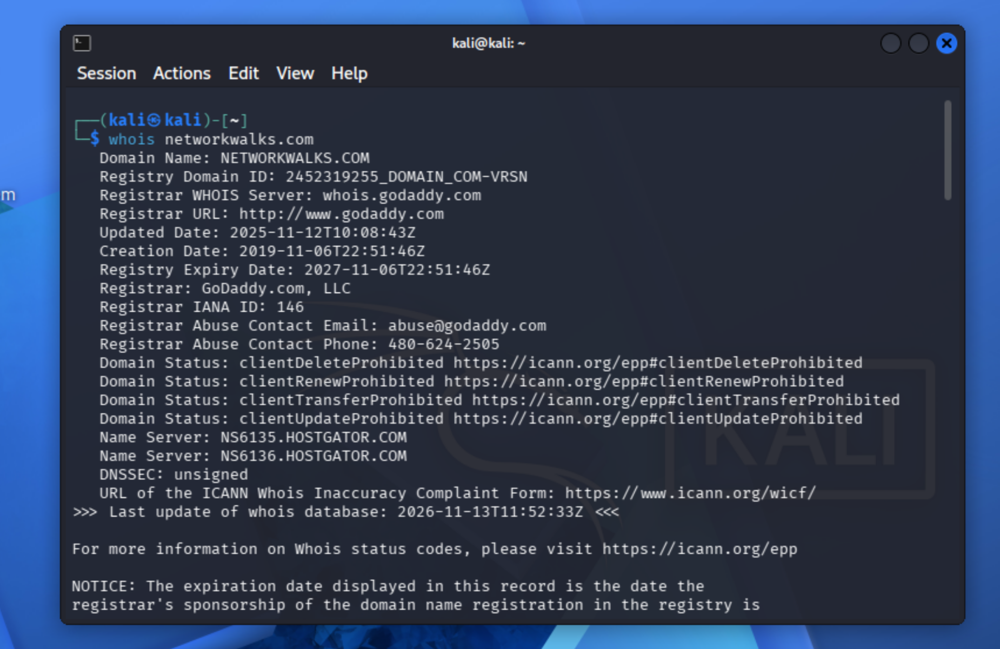

**Evidence 2 — WhatWeb technology fingerprint**

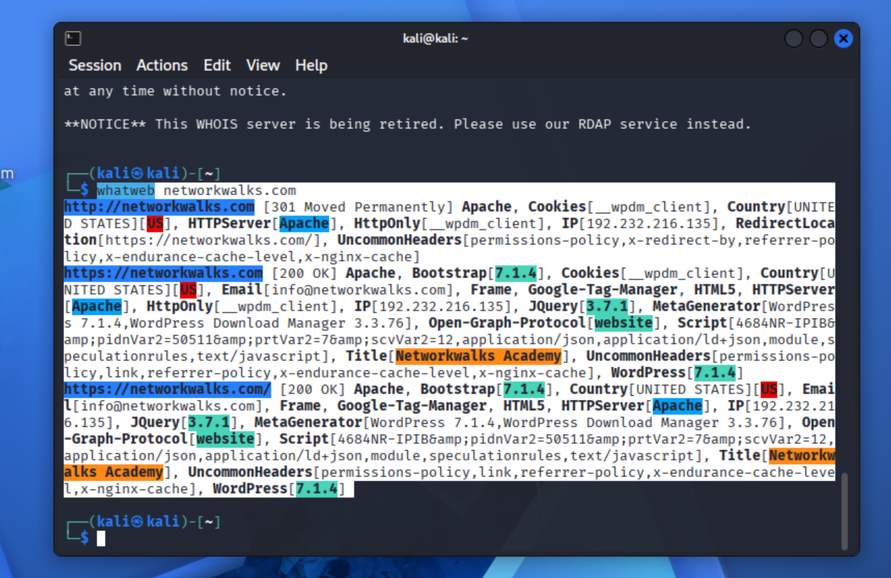

**Evidence 3 — Nslookup resolving the domain to its IP address**

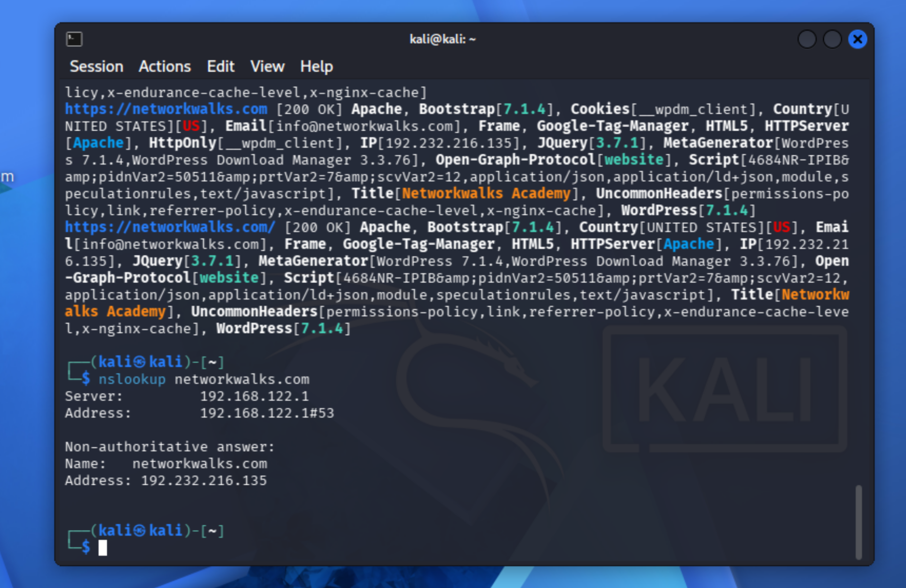

**Evidence 4 — Curl HTTP response headers**

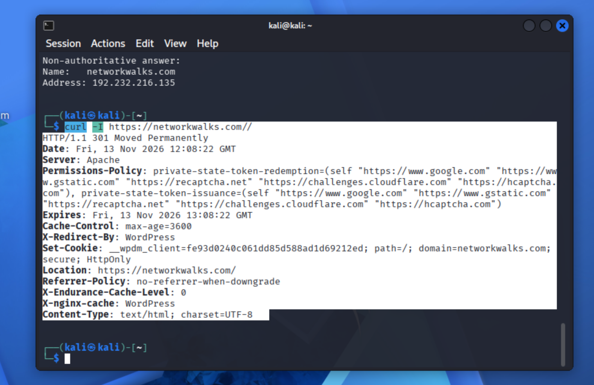

**Evidence 5 — Wafw00f detecting the ModSecurity WAF**

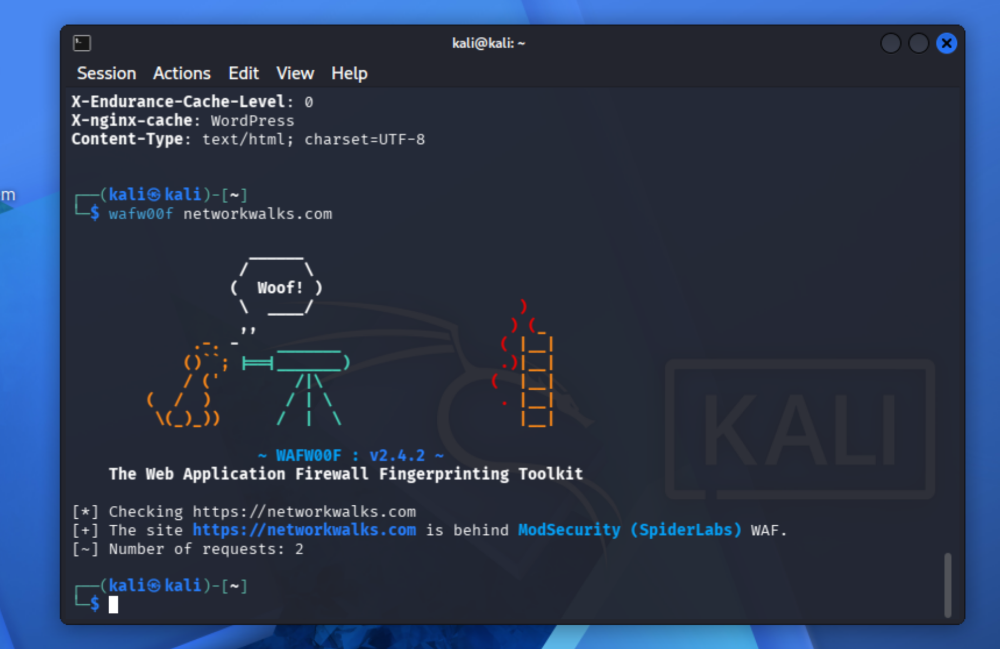

**Evidence 6 — DNSRecon enumeration results**

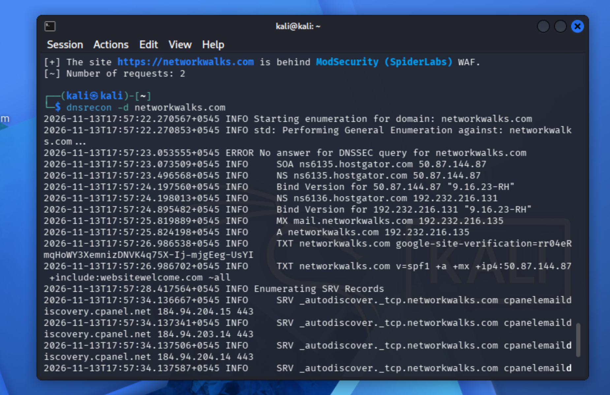

**Evidence 7 — Local IP, subnet and gateway identified with `ipconfig`**

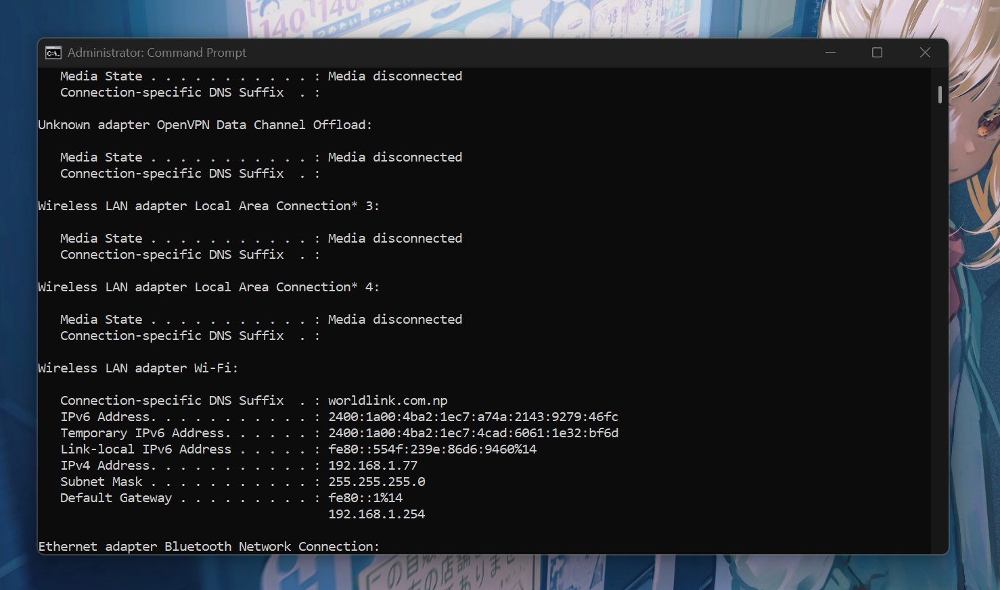

**Evidence 8 — Zenmap ping scan of `192.168.1.77/24` (7 hosts up)**

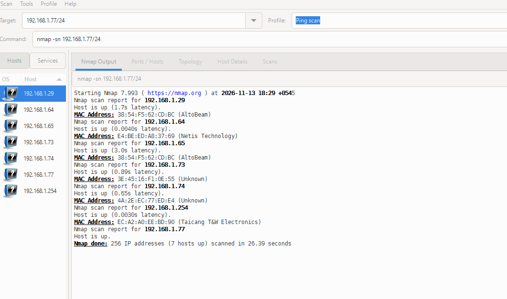

**Evidence 9 — Zenmap ping scan of `192.168.1.0/24` (11 hosts up)**

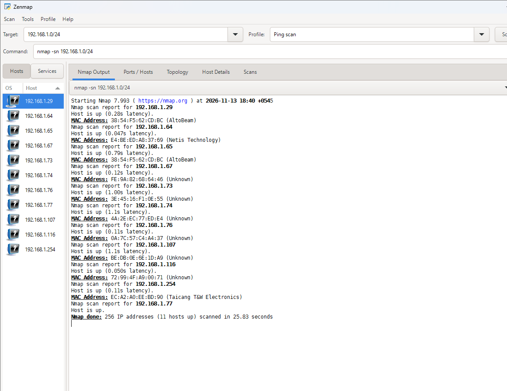

**Evidence 10 — Zenmap network topology map**

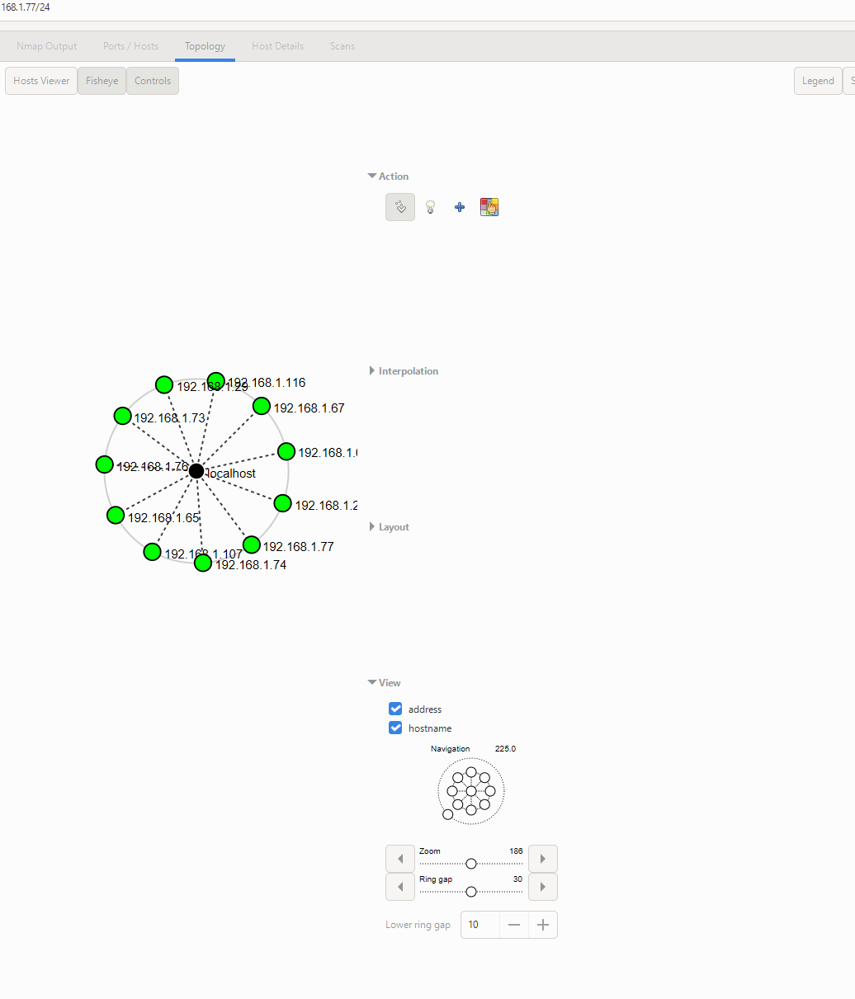

**Evidence 11 — Zenmap practice lab result (100%)**

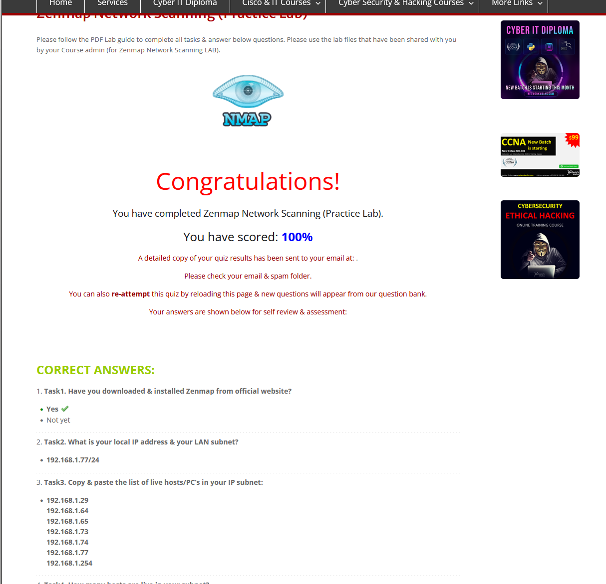

-End-
